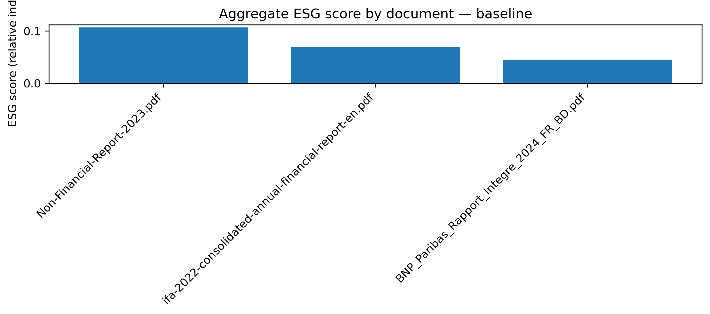
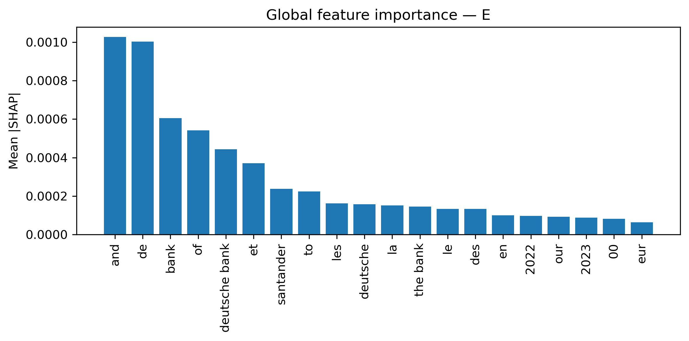
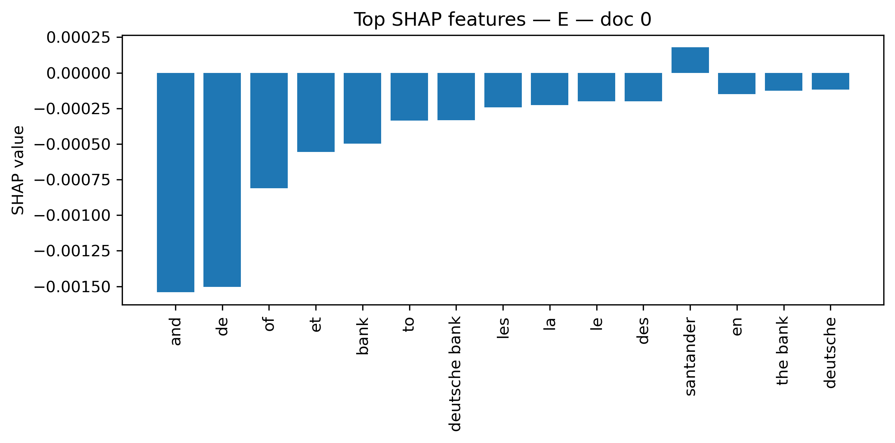

# Explainable ESG Scoring Using NLP and XAI

### An Interpretable ESG Scoring Framework for European Banking Reports

**Academic Research Project | MSc Big Data & Artificial Intelligence for Business**

## 1. Project Overview

Environmental, Social, and Governance (ESG) assessments play an increasingly important role in banking, sustainable finance, risk management, and investment decisions.

However, traditional ESG ratings often face challenges related to transparency, methodological differences, and comparability.

This project explores how Natural Language Processing (NLP) and Explainable Artificial Intelligence (XAI) can be used to extract ESG-related signals from publicly available banking reports.

The objective is to develop a lightweight, interpretable Python pipeline that generates Environmental (E), Social (S), Governance (G), and aggregate ESG scores while providing explanations for the underlying results.

The project was developed as part of my MSc thesis at Montpellier Business School.

## 2. Business Problem

Financial institutions publish extensive annual and sustainability reports containing valuable ESG information.

Analyzing these documents manually can be time-consuming, while automated scoring methods may lack interpretability.

This project addresses the following research question:

**Can financial reports be used to generate transparent, explainable, and comparable text-based ESG scores?**

The proposed framework aims to:

- Automate ESG-related text analysis.
- Identify environmental, social, and governance indicators.
- Generate interpretable ESG disclosure scores.
- Explain the textual features influencing each score.
- Support preliminary ESG screening and financial analysis.

## 3. Dataset

The prototype analyzes three publicly available European banking reports:

| Financial Institution | Reporting Year |
|---|---|
| BNP Paribas | 2024 |
| Deutsche Bank | 2023 |
| Banco Santander | 2022 |

The reports contain financial and non-financial disclosures used to identify ESG-related terminology and patterns.

**Data source:** Publicly available corporate annual and non-financial reports.

**Important:** This is a small exploratory sample, not a representative dataset of the European banking sector.

## 4. Technologies and Tools

**Programming Language**
- Python

**Data Processing**
- Pandas
- NumPy
- PDFMiner
- PyMuPDF

**Natural Language Processing**
- Scikit-learn
- TF-IDF Vectorization
- Unigrams, bigrams, and trigrams
- ESG-specific bilingual lexicons

**Machine Learning**
- Ridge Regression

**Explainable Artificial Intelligence**
- LIME
- SHAP

**Visualization**
- Matplotlib

**Development Environment**
- Jupyter Notebook

## 5. Methodology

The analytical pipeline consists of six main stages.

### Step 1: Financial Document Collection

Publicly available banking reports are collected and organized for analysis.

### Step 2: PDF Text Extraction

Text is extracted from PDF documents using PDFMiner, with PyMuPDF as an alternative extraction method.

### Step 3: Text Preprocessing

The extracted text is normalized and prepared for analysis.

Preprocessing includes:

- Lowercase conversion
- Accent normalization
- Whitespace cleaning
- Text standardization

### Step 4: NLP Feature Engineering

TF-IDF vectorization transforms unstructured financial text into numerical features.

The implementation supports n-grams ranging from 1 to 3 words, enabling the identification of individual ESG-related terms and multiword expressions.

Bilingual ESG lexicons are used to associate relevant textual features with three dimensions:

- **E — Environmental:** Climate change, emissions, sustainability, and environmental risks.
- **S — Social:** Employees, human rights, diversity, and social responsibility.
- **G — Governance:** Compliance, transparency, corporate governance, and risk management.

### Step 5: ESG Score Construction

An interpretable lexical scoring approach is used to calculate separate Environmental, Social, and Governance scores.

The three dimensions are combined into an aggregate ESG disclosure score using a transparent aggregation approach.

A lightweight Ridge Regression model is also used as a function for explainability analysis.

### Step 6: Model Explainability

Two Explainable AI methods are applied.

**LIME — Local Interpretable Model-Agnostic Explanations**

LIME identifies textual features that influence a model prediction for an individual document.

**SHAP — SHapley Additive exPlanations**

SHAP measures feature contributions and supports both local and global interpretation.

Together, these methods provide additional transparency into the NLP scoring framework.

## 6. Results and Findings

The prototype successfully processes the three financial reports and generates interpretable ESG disclosure indicators.

The exploratory analysis produced the following ranking of aggregate text-based ESG scores:

1. Deutsche Bank
2. Banco Santander
3. BNP Paribas

Additional observations include:

- Deutsche Bank exhibited relatively stronger Environmental and Social disclosure signals.
- Banco Santander demonstrated a relatively stronger Governance profile.
- LIME and SHAP helped identify textual features influencing the model's outputs.
- The analysis demonstrated the feasibility of an explainable NLP-based ESG screening prototype.

These findings are specific to the selected documents, reporting periods, and scoring methodology.

**The resulting scores measure ESG-related disclosure signals, not independently verified corporate sustainability performance.**

## 7. Explainability and Visualizations

The project generates visual and structured outputs to support interpretation.

### ESG Score Comparison



### SHAP Global Feature Importance



### SHAP Local Feature Contributions



Additional outputs include:

- ESG score tables in CSV format
- LIME feature contribution results
- ESG explanation dictionaries in JSON format

## 8. Project Structure

```text
explainable-esg-scoring-nlp/
│
├── data/
│   ├── BNP_Paribas_Rapport_Integre_2024_FR_BD.pdf
│   ├── Non-Financial-Report-2023.pdf
│   └── ifa-2022-consolidated-annual-financial-report-en.pdf
│
├── results/
│   ├── figure_esg_scores_baseline.png
│   ├── shap_global_importance_E.png
│   ├── shap_top_features_E_doc0.png
│   ├── esg_results_baseline.csv
│   ├── esg_explanations_top_tokens.json
│   └── lime_top_features_E_doc0.csv
│
├── explainable_esg_scoring_nlp.ipynb
├── README.md
├── requirements.txt
└── .gitignore
```

The structure above represents the intended repository organization. The `requirements.txt` and `.gitignore` files should be added before publication.

## 9. Installation and Usage

Clone the repository:

```bash
git clone https://github.com/cindyadou00/explainable-esg-scoring-nlp.git
cd explainable-esg-scoring-nlp
```

Install the required dependencies:

```bash
pip install -r requirements.txt
```

Launch Jupyter Notebook:

```bash
jupyter notebook
```

Open `explainable_esg_scoring_nlp.ipynb`.

Run the notebook cells sequentially to reproduce the ESG scoring and explainability analyses.

Ensure the required financial reports are available in the `data/` directory.

## 10. Limitations

This project is an exploratory academic prototype and has several limitations:

- **Small sample size:** Only three financial reports were analyzed.
- **Reporting-year differences:** The documents cover different years, limiting direct comparisons.
- **Lexicon dependency:** Results depend on the coverage and quality of ESG-specific terminology.
- **Disclosure bias:** Strong ESG reporting does not necessarily imply strong ESG performance.
- **Language differences:** French and English reporting practices may influence extracted signals.
- **Limited external validation:** The prototype does not establish equivalence with established ESG rating agencies.

The results should therefore be interpreted as exploratory indicators rather than definitive ESG ratings.

## 11. Future Improvements

Potential extensions include:

- Expanding the dataset to additional European banks and reporting years.
- Introducing section-level ESG analysis.
- Improving bilingual ESG lexicons.
- Evaluating model stability and sensitivity.
- Comparing text-based ESG scores with external market benchmarks.
- Developing an interactive Power BI dashboard.
- Exploring transformer-based NLP models such as FinBERT.
- Improving the validation of LIME and SHAP explanations.

## 12. Business Applications

Potential applications include:

**Banking and Risk Management**

Supporting preliminary ESG screening and identifying relevant sustainability disclosures.

**Financial Analysis**

Comparing ESG-related communication across financial institutions.

**Regulatory and Compliance Analysis**

Assisting analysts in reviewing large volumes of non-financial disclosures.

**Business Intelligence**

Transforming unstructured documents into interpretable indicators and visual reporting outputs.

## 13. Author

**Cindy Adou**

MSc Big Data & Artificial Intelligence for Business  
Montpellier Business School, France

**Areas of Interest:** Data Analytics | Business Intelligence | Banking & Financial Risk | Python | NLP | Explainable AI

---

*This project is based on academic research and is intended for educational, exploratory, and portfolio purposes.*
